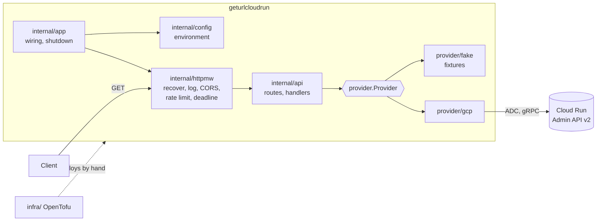

# GetUrlCloudRun

Read-only HTTP API in Go that returns the URLs of the Cloud Run services of one GCP project and region, with a deterministic fake provider for offline use and an OpenTofu configuration that deploys it.

[](https://github.com/PaulPerigault/GetUrlCloudRun/actions/workflows/ci.yml)
[](https://scorecard.dev/viewer/?uri=github.com/PaulPerigault/GetUrlCloudRun)
[](go.mod)
[](LICENSE)

## Overview

Cloud Run gives every service a generated URL, and a script or a front end that needs to call a sibling service has to look it up. This service does that lookup behind a small JSON API, so a caller needs one URL instead of a `gcloud` session.

The engineering choices, each with an ADR:

- The Google client sits behind a `provider.Provider` interface. A fake implementation serves recorded fixtures, so the binary, the tests and the demo run with no GCP account and no network ([ADR 0002](docs/adr/0002-provider-interface-and-fake.md)).
- The HTTP layer is the standard library, with an explicit CORS allow-list that refuses by default, a global rate limit, a deadline on every request and generic error messages ([ADR 0001](docs/adr/0001-standard-library-http.md)).
- Callers are authenticated by Cloud Run IAM, not by the code: the deployed service is private unless you say otherwise ([ADR 0003](docs/adr/0003-authentication-delegated-to-cloud-run.md)).
- The infrastructure is OpenTofu, pinned and tested with a mocked provider. CI validates it and never applies it ([ADR 0004](docs/adr/0004-opentofu-and-no-apply-in-ci.md)).

## Context

- **Period:** 2026-04 to 2026-04 in Git: the original history is a single commit, the clean base of 2026-04-27, so the Git date is the date of that clean-up, not of the work. The first version was built in 2024 (month unknown). Rewritten and industrialized on 2026-11-12.
- **Origin:** work-study. No employer, client, person or machine name appears in this repository.
- **Why:** a need met at work, retrieving the URLs of the Cloud Run services of a GCP project, and a chance to learn the Google Cloud tooling. Source: the repository description, the owner's statement of 2026-11-12.
- **What was redone, and when (2026-11-12):** Go 1.22 (end of life) to 1.27 with a pinned toolchain; Gin and its CORS middleware replaced by the standard library; the GCP client behind an interface with a fake provider; CORS, errors, deadlines, shutdown and logging fixed; the Terraform files, whose interpolations were empty and so invalid, rewritten for OpenTofu; the CI job that ran `terraform apply` removed; tests, linting, Dockerfile, pinned tools, hooks and documentation added.

## Architecture



`internal/provider/gcp` is the only package that imports a Google library; `depguard` enforces the direction of every import (see [AGENTS.md](AGENTS.md)).

## Quick Start

No GCP account is needed: the fake provider is the default of `.env.example`.

```bash
git clone https://github.com/PaulPerigault/GetUrlCloudRun.git
cd GetUrlCloudRun
task setup     # modules, .env, Git hooks
task demo      # builds the binary, runs it offline, calls every route and checks the answers
```

`task demo` printed, on the author's machine (the real binary with the fake provider):

```console
GET /health                      -> 200 {"provider":"fake","status":"ok"}
GET /api/v1/services             -> 200 [{"name":"billing-api","url":"https://billing-api-demo-ew.a.run.app"},{"name":"catalog","url":"https://catalog-demo-ew.a.run.app"},{"name":"hello","url":"https://hello-demo-ew.a.run.app"},{"name":"orders-worker","url":"https://orders-worker-demo-ew.a.run.app"},{"name":"web-frontend","url":"https://web-frontend-demo-ew.a.run.app"}]
GET /api/v1/services/hello       -> 200 {"url":"https://hello-demo-ew.a.run.app"}
GET /api/v1/services/absent      -> 404 {"error":"service not found"}
GET /api/v1/services/Bad_Name    -> 400 {"error":"invalid service name"}
demo: ok
```

To keep a server running: `task dev` (fake provider, `http://localhost:8080`). To run the container offline: `task demo:docker`.

Against a real project, with Application Default Credentials (`gcloud auth application-default login`):

```bash
PROVIDER=gcp GCP_PROJECT_ID=<your-project> GCP_REGION=us-central1 go run ./cmd/geturlcloudrun serve
```

## Usage

Routes, all `GET`:

| Route | Answer |
| --- | --- |
| `/health` | `{"status":"ok","provider":"fake"}`, never rate limited |
| `/api/v1/services` | array of `{"name","url"}`, sorted by name |
| `/api/v1/services/{name}` | `{"url"}`, `400` for an invalid name, `404` if absent |

Other statuses: `405` for another method, `429` when the rate limit is hit, `502` when the Cloud Run API fails, `504` when it is too slow. The body is always a fixed `{"error": "..."}`; the detail is in the server log.

Sample output, replayed against the real router with the fake provider (generated by `task docs:readme`, checked by `task check:docs`):

<!-- BEGIN api-output (generated by `task docs:readme`, do not edit) -->
```console
$ curl -s -w ' [HTTP %{http_code}]\n' http://localhost:8080/health
{"provider":"fake","status":"ok"} [HTTP 200]
$ curl -s -w ' [HTTP %{http_code}]\n' http://localhost:8080/api/v1/services
[{"name":"billing-api","url":"https://billing-api-demo-ew.a.run.app"},{"name":"catalog","url":"https://catalog-demo-ew.a.run.app"},{"name":"hello","url":"https://hello-demo-ew.a.run.app"},{"name":"orders-worker","url":"https://orders-worker-demo-ew.a.run.app"},{"name":"web-frontend","url":"https://web-frontend-demo-ew.a.run.app"}] [HTTP 200]
$ curl -s -w ' [HTTP %{http_code}]\n' http://localhost:8080/api/v1/services/hello
{"url":"https://hello-demo-ew.a.run.app"} [HTTP 200]
$ curl -s -w ' [HTTP %{http_code}]\n' http://localhost:8080/api/v1/services/absent
{"error":"service not found"} [HTTP 404]
$ curl -s -w ' [HTTP %{http_code}]\n' http://localhost:8080/api/v1/services/Bad_Name
{"error":"invalid service name"} [HTTP 400]
```
<!-- END api-output -->

Commands of the binary: `geturlcloudrun serve` (default), `geturlcloudrun healthcheck` (used by Docker, the image has no shell) and `geturlcloudrun version`.

### Configuration

Environment variables, validated at start-up (every problem is reported at once). `.env.example` lists them with local values.

| Variable | Default | Meaning |
| --- | --- | --- |
| `PROVIDER` | `gcp` | `gcp` or `fake`. The default fails closed: without `GCP_PROJECT_ID` the service does not start |
| `GCP_PROJECT_ID` | none | Required with `gcp` |
| `GCP_REGION` | `us-central1` | Region listed |
| `PORT` | `8080` | Listen port (Cloud Run sets it) |
| `ALLOWED_ORIGINS` | empty | Exact CORS origins, comma separated. Empty refuses CORS; `*` is rejected |
| `REQUEST_TIMEOUT` | `5s` | Deadline of each request, at most `1m` |
| `SHUTDOWN_TIMEOUT` | `10s` | Drain time on SIGINT or SIGTERM |
| `RATE_LIMIT_RPS`, `RATE_LIMIT_BURST` | `20`, `40` | Global token bucket |
| `LOG_LEVEL`, `LOG_FORMAT` | `info`, `json` | `slog` output on stdout |

## Development

```bash
task verify     # what CI runs: format, lint, tests -race with the 85 percent gate, docs, skills, infra, security
task test       # tests and coverage gate only
task lint       # go vet and golangci-lint (depguard, funlen, gocyclo)
task lint:actions  # actionlint on the workflows
task lint:zizmor   # zizmor 1.32.0 offline (Docker, pinned digest), same version as CI; not in verify
task --list     # every target
```

Infrastructure (`task infra:tool`, `infra:fmt`, `infra:lint`, `infra:validate`, `infra:test`, `infra:scan`) needs no credential. Deploying is manual and documented in [infra/README.md](infra/README.md). Contribution rules: [CONTRIBUTING.md](CONTRIBUTING.md). Decisions: [docs/adr](docs/adr), [docs/decisions-log.md](docs/decisions-log.md).

## Project Structure

```text
cmd/geturlcloudrun/   main only
internal/app/         wiring, server lifecycle, serve, healthcheck, version
internal/api/         routes and handlers
internal/httpmw/      recover, access log, CORS, rate limit, deadline
internal/config/      environment variables
internal/provider/    the contract, with fake/ and gcp/ implementations
internal/version/     build metadata
infra/                OpenTofu configuration, tests, allowed-destroys.txt
dev/                  developer programs (checkdocs, readme-gen, covercheck, demo, toolfetch, plancheck, ...)
tools/                separate module: pinned dev tools
docs/                 ADR, decisions log, journal, upstream notes
.github/              workflows, labels, milestones, issue forms, backlog, ruleset
```

## Related

- [paulperigault.fr](https://paulperigault.fr), the author's portfolio.
- [design-system](https://github.com/PaulPerigault/design-system), the author's design system. This service has no web interface, so it does not consume it.

## Roadmap

See the [milestones](https://github.com/PaulPerigault/GetUrlCloudRun/milestones): `v0.2.0` to `v1.0.0` are written ahead in [.github/backlog](.github/backlog), from CI proof on real runners to a frozen `/api/v1` contract.

## Limits

- Lists one project and one region. It does not cover several projects or regions in one call.
- Read-only: it never creates, changes or deletes a Cloud Run service.
- The rate limit is global, not per client (Cloud Run hides the client address behind its front end); one noisy caller can use the whole budget.
- No cache: each list is one call to the Cloud Run Admin API, and the API has its own quotas.
- Behaviour against the real Cloud Run Admin API is covered by an in-process gRPC server that speaks the same protocol, not by a call to Google. The first real run is the owner's.
- The infrastructure code is validated and tested with a mocked provider. It has not been planned or applied against a real project.
- CodeQL and OpenSSF Scorecard run only once the repository is public (they need GitHub Advanced Security, free on public repositories). While it is private, the coverage is gitleaks, govulncheck, Trivy and zizmor, and the required `ci` check treats the skipped jobs as passed.
- The deployed service is private by default: callers need an identity token with the invoker role.
- The GCP provider has never been exercised against a real cloud, neither Google Cloud nor Cloud Run: only the fake provider and the in-process gRPC server have run.
- Provenance: written in a company setting in 2024. No forbidden name is configured for the publication check, because none was supplied (provenance entreprise 2024, aucun nom interdit configuré).

## Author

Paul Perigault, Cloud & DevOps Engineer | [paulperigault.fr](https://paulperigault.fr)
